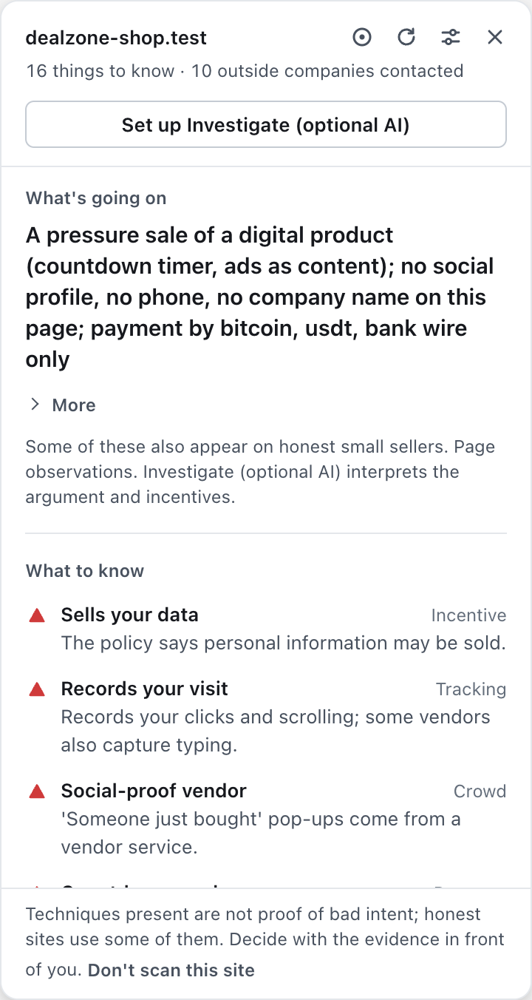

# Subtext

**A browser extension that shows you the subtext of the page you're on: what it is doing to you, who is behind it, and what they get if you comply.**
It flags dark patterns, manufactured urgency, social-proof theatre, rhetorical and logical tricks, emotional and tribal framing, cognitive-bias pricing, interpersonal-manipulation tactics (love bombing, negging, isolation, DARVO…), misleading charts, trackers and data brokers, the site's business model and incentives, red-flag clauses in its privacy policy and terms, undisclosed commercial relationships, and who owns and funds the outlet. Every flag is a short warning label, a one-line reason, and on click the full explanation of the psychology behind it and what to do.

Status: **proof of concept (v0.2)**. No person has labelled its results: every accuracy figure in the docs comes from AI judges or from checks in code, not from people. Treat what it reports as leads to check, not as findings. Built and tested on Chromium: load it in Chrome, Edge, Brave or Arc (Chrome 110 or newer). Safari and Firefox are not built or tested yet. Scanning runs locally, the site's own privacy and terms pages are fetched on load (see [Privacy](#privacy)), and an optional AI deep-analysis layer uses your own Claude (Anthropic) or ChatGPT (OpenAI) API key. The ChatGPT path has not been run with a real key; its model ids and prices are unverified.

Some data files are not in the public copy of this project, so a few features are inactive there: see [Data held out of the public copy](#data-held-out-of-the-public-copy).

[Project page with examples](https://joshcs.github.io/subtext/) · [Run the demo](DEMO.md) · [Privacy](PRIVACY.md) · [Contributing](CONTRIBUTING.md) · [Security](SECURITY.md) · [Changelog](CHANGELOG.md)



The picture shows the panel on an invented shop page from this repository's test fixtures.

Docs: [plan](docs/PLAN.md) · [research report](docs/RESEARCH.md) · [master list of techniques](docs/TAXONOMY.md) · [how warnings are communicated](docs/UX.md) · [scoring & calibration](docs/CALIBRATION.md) · [data sources](docs/DATA-SOURCES.md) · [licensing & governance](docs/LICENSING.md) · [threat model: copying, evasion, misuse](docs/THREAT-MODEL.md) · [how the public copy is made](docs/PUBLISHING.md)

## Where to find things

| Path | What it is |
|---|---|
| `extension/` | The extension itself. Load this folder in the browser. |
| `extension/rules/` | The checks as data: text rules, label wording, policy clauses, tracker domains and which checks may show a label. |
| `extension/data/` | Bundled tables: outlets, owners, SEC tickers and statistical series. |
| `test/` | The tests and their invented fixture pages. |
| `eval/` | Evaluation scripts. Most need recorded pages that are not in this copy. |
| `scripts/` | Validation, packaging, demo and data-build scripts. |
| `data/` | Hand-kept warning-list additions and removals, and the per-rule evidence ledger. |
| `docs/` | Design, research and measurement documents. |
| [DEMO.md](DEMO.md) | How to run the demo and try the AI features. |
| [PRIVACY.md](PRIVACY.md) | Every request the extension can make, by trigger, with each setting's default. |
| [CONTRIBUTING.md](CONTRIBUTING.md) | How to report a wrong label, correct data, add a check and run the tests. |
| [SECURITY.md](SECURITY.md) | Where to report a security problem or an error about a person. |
| [CHANGELOG.md](CHANGELOG.md) | What each version contains. |
| [docs/TAXONOMY.md](docs/TAXONOMY.md) | The master list of techniques. |
| [docs/UX.md](docs/UX.md) | The rules for label wording. |
| [docs/RELIABILITY.md](docs/RELIABILITY.md) | Which checks may show a label, and the evidence for each. |
| [docs/CALIBRATION.md](docs/CALIBRATION.md) | How the checks were measured. |
| [docs/THREAT-MODEL.md](docs/THREAT-MODEL.md) | Copying, evasion and misuse. |
| [docs/PUBLISHING.md](docs/PUBLISHING.md) | How the public copy is made and what is held out of it. |
| [docs/LICENSING.md](docs/LICENSING.md), `LICENSE`, `LICENSE-DATA`, `NOTICE` | The licences and where each data file comes from. |

The full file list is under [Project layout](#project-layout).

## How it talks to you

Three tiers, so a page with sixty findings is still readable:

| Tier | Where | What |
|---|---|---|
| 0 · glance | toolbar badge and a small in-page pill | the strongest flag by name; no letter grade and no single score, because a page is not one metric |
| 1 · label | "What to know" chips in the panel and popup, in-page hover tooltip | a warning-sign name of 1–3 words with a category icon and severity colour, e.g. **Fake deadline**, **No 'reject' button**, **Sells your data** |
| 2 · why | next to each chip, in the hover tooltip | one pointed sentence under 12 words: *"This timer restarted on reload. It's not real."* |
| 3 · detail | click, in the panel | technique, full explanation, the mechanism ("why it works on you"), evidence you can click to locate on the page, a one-minute counter-move, source links |

Nothing is drawn over the page: no outlines, no boxes. Rest the mouse on a flagged element and a small tooltip names the technique and the why; click the pill or the Subtext toolbar icon for the full breakdown in a resizable panel docked to the right of the page. Small dot markers are available behind a toggle in the panel, off by default. All label copy lives in one file, `extension/rules/labels.json`, and is governed by the rules in [docs/UX.md](docs/UX.md).

## What it checks (v0.2)

| Layer | What | How |
|---|---|---|
| Text | 86 regex rules, most of them held back until they prove reliable ([docs/RELIABILITY.md](docs/RELIABILITY.md)): urgency/scarcity, social proof, clickbait & engagement bait, 20 rhetorical fallacies and propaganda devices, outrage/fear/tribal/dehumanizing lexicons, pricing & framing biases, love bombing/negging/isolation/DARVO/gaslighting/hoovering, deceptive claims (asterisks, "unlimited", miracle cures, get-rich, greenwashing), confirmshaming, trick questions, cancellation friction | Runs over visible text; "experts say" is only flagged when no link is nearby |
| Structure | Pre-checked boxes, crossed-out anchors, "most popular" tiers, cookie-consent asymmetry (no reject, or reject visually buried), modal choice asymmetry, disguised ads & tiny "Sponsored" labels, trust-badge images, content gates, engagement feeds, notification pre-prompts, animated CTAs, sticky overlays | DOM + computed styles (size, contrast, colour, motion) |
| Behaviour | Live countdowns and **countdowns that reset between visits**, infinite scroll, interrupting & exit-intent pop-ups, nagging, autoplay, tab-title bait | Observers over time; timer state stored per URL |
| Charts | Inline SVG axis analysis: non-zero baseline on bars, zoomed line axes, dual axes, inverted axis, log/irregular intervals, short time window, missing units, missing source; detection of canvas, embedded and image charts for the AI layer | Parses SVG text labels and geometry |
| Trackers | 511 vendor domains in 23 categories, including session replay, fingerprinting, social-proof-toast vendors, evergreen-countdown vendors, pop-up capture, BNPL, native-ad networks; affiliate links with disclosure check | Resource hosts + script/iframe/link sources |
| Source | 134 outlets / 212 domains: ownership chain, owner kind and why it matters, funding model, coarse lean from third-party raters, sources, confidence; one-click lookups on 11 registries for unknown outlets; byline/date/about/contact/corrections checks; advocacy names without funding disclosure | Bundled dataset + page structure |
| Warning lists | Lists of domains that other people keep, built into one file and looked up locally: 43,537 entries in the full build of 6 November 2026, from the Czech Trade Inspection Authority's risky e-shops, HaGeZi's Fake filter list, the phishing-filter list, the ESMA register and the French AMF blacklists, plus hand additions that each cite a published source (none yet). A hit is worded as who listed the site and when, for example "Listed by the Czech Trade Inspection Authority on 2026-03-01.", with the label "Warning list" and the source's own caveat; it says Subtext did not reach this conclusion itself and never gives a verdict of ours. **This file is not in the public copy, so this check is inactive there.** | `extension/data/known-bad.json`, rebuilt by `npm run lists`; no visited site leaves the browser for this |
| Incentives | Business-model inference (ads, data collection, affiliate, subscription, direct sales, lead generation, donations, sponsorship); "free to use, paid with your data"; "Do Not Sell or Share" link (a legal admission of selling/sharing); data-broker and identity-graph vendors; lead-capture forms; **privacy policy and terms scan** for 30 clause types (sells data, shares for partners' marketing, data brokers, profile building, precise location, biometric, cross-device, indefinite retention, forced arbitration, unilateral changes, children's data, automated decisions, email tracking, hard opt-out, data sold with the company, account closed at their discretion, content removed at their discretion, disputes in a court they chose, the law they chose, using the site counts as agreeing, limits on what they owe you, ignores Do Not Track (the last seven measured against CLAUDETTE-142, an expert-tagged set of 142 terms of service, and OPP-115, 115 privacy policies annotated by law students: CALIBRATION section 11); plus positive signals: no-sale statement, GPC honoured, deletion right); optional ToS;DR rating | Page signals; the policy is fetched from the site itself on load and scanned locally |
| AI inquiry (optional) | Chooses a consequential question, reads up to two supported public sources, writes one specific interpretation, then a second model pass checks identity, timing, scope and inference; if that pass rewrites the reading, the rewrite is labelled as such and is not reviewed again. Quotes must match the supplied evidence, and every shown line may name only people and organisations present in it. | Three bounded model stages using your API key. A one-pass mode remains available for chart images and detailed findings. |

Every finding carries: technique, severity (1–3), confidence, the mechanism it exploits ("why it works on you"), evidence you can click to highlight on the page, and a counter-move. The toolbar badge counts what is worth knowing and the in-page pill names the strongest flag. No letter grade or score reaches a reader: a page is not one metric.

## Install

### Chrome, Edge, Brave, Arc (unpacked)
1. Download or clone this repository.
2. Open `chrome://extensions` (Edge: `edge://extensions`, Brave: `brave://extensions`).
3. Turn on **Developer mode** (top right).
4. Click **Load unpacked** and choose the `extension/` folder.
5. Pin the icon. Visit any page; the badge counts what is worth knowing, and clicking the icon opens the report panel on the page.

To share with others without a store listing, `npm run package` produces `dist/subtext-0.2.0.zip`, licence texts included, that they can unzip and load the same way.

### Safari and Firefox
Neither is built or tested. Safari should be possible through Apple's `xcrun safari-web-extension-converter`, and Firefox would at least need a `background.scripts` fallback and its own test run. Until someone does that work, treat both as not supported.

## Using it
- **Badge / pill**: the pill names the strongest flag, and the badge counts flags. Only rules that have proved reliable on real pages can flag ([docs/RELIABILITY.md](docs/RELIABILITY.md)). Click the pill to open the report panel on the page; drag its left edge or bottom to resize it (the size is remembered); hover a finding in it to see where on the page it sits, click a quote to scroll there.
- **Hover**: rest the mouse on a flagged element for its label and one-line why; "Details" expands the explanation, "Open in panel" jumps to the full entry. Escape closes it. Turn hover tooltips off in Settings.
- **What's going on** starts with what the browser can observe: for example, who owns the outlet, who gets paid on a sale, or how a subscription renews. A recorded policy for a particular section applies only when the article address establishes the section and date. On a Washington Post opinion piece after February 26, 2025, the panel can name Bezos's published policy; an ordinary news report gets ownership context only.
- **Shop facts**: on a page that sells, the report states plain facts about the seller, for example "no social profile, no phone, no company name on this page", each with how often the same fact shows on shops from public warning lists and on honest shops. It never calls a shop dishonest. Only the rare combination (no real social profile, no phone and no company name) reaches the one-line summary, and not when a record names the site's owner. The truth of these facts is measured by `eval/fact-check.py` ([docs/CALIBRATION.md](docs/CALIBRATION.md) section 10).
- **Purchase path**: one finding on pages that sell something, with the same facts in its detail. Severe only when payment is irreversible-only or a guarantee is contradicted on the same page.
- **Who is behind this?** Known outlets get the ownership and funding card, folded to one line ("Owned by X. Subtext's checks found no link between this page and its owner's listed businesses, causes or wealth.") unless the page's subject touches the owner's interests. That means the page names the owner or a funder, or it is about one of the owner's businesses, a government that funds the outlet, a cause the owner backs (`extension/data/owner-interests.json`, one source per interest; not in the public copy, where only a named owner or funder, or private equity at a fund-owned outlet, opens the card), or taxes on the very wealthy when the owner is a billionaire or a wealthy family, or private equity when a fund owns it. A topic counts in the title or a heading, or when it comes up twice in the text. Then the card opens with "Possible connection to the owner:" and the reason, for example "This page is about taxes on the very wealthy, and The Washington Post is owned by Jeff Bezos, a billionaire." The same test decides whether the top line mentions the owner. These rules only suggest connections; Investigate receives the owner's full record and judges whether a relationship matters to what the page argues, including links no keyword would catch (competitors, suppliers, regulators, donors, the author's own business). A page labelled as paid for ("Paid for by", "Paid content", "This article is presented by") leads the top line with who paid, read from the label or the sponsor's logo; sponsored-story widgets (Taboola, Outbrain) are counted as native ads, not as the publisher's commission links. Republished reporting leads the top line too ("This is The Associated Press's reporting, republished here"), read from an AP, Reuters or AFP byline or copyright line or an "originally published by" note; photo credits do not count. Unknown ones get one line, for example "Does not say who runs it: no legal pages, no address or company name, registrant hidden", and one finding ("Unnamed operator"). "Show the checks" unfolds what was looked for: privacy, terms and legal-notice links, a postal address, a legal entity or registration number, the copyright holder, a named author, how to reach them, hosting platform, and, if you opt in, the domain's registration date and whether a registrant is named. Each row says found or not found on this page; nothing is a verdict. Sites on a hosting platform (Substack, Shopify, Wix, WordPress.com, Webflow ... recognised from the platform's own domain or its CDN assets) read as "hosted on X: the account holder is the publisher"; .gov, .edu and similar registries read as the institution they are restricted to.
- **Report window**: where no panel can open (browser pages, the web store, a page loaded before install), the toolbar icon opens the same report in a small window: source card (who owns this outlet, funding, lean with links to raters), then categories sorted by weight. Expand a finding for the explanation, the mechanism, evidence (click to scroll to it) and what to do.
- **Compare the source**: beside a supported citation, click **Compare SEC filing**, **Compare study abstract**, or **Compare trial registration**. Subtext puts a sentence from the article next to passages from the actual document. Where the evidence is specific enough, it can distinguish a product launch from a shareholder pitch, a share sale from money raised for the company, or a relative effect from the event rates in both groups. A source that supports the article can say so. No key needed. Supported records: SEC archive HTML, PubMed and DOI articles indexed with an abstract in Europe PMC (including supported NEJM and Nature URLs), and ClinicalTrials.gov registrations. For the distinctive October 2016 Tesla/SolarCity solar-roof unveiling, Subtext can suggest the shareholder letter even without a citation. The panel labels this as a related record. Many articles have no supported record.
- Without a key, Subtext can also translate a monthly price into its annual amount when the terms and two buttons are in the same dialog, and read an explicit public-comment-for-private-message offer on an identifiable standalone post. For **four working examples**, run `npm run demo:investigate -- --refresh` once (three requests to sec.gov and ebi.ac.uk save the public records locally), then `npm run demo:investigate`; [demo setup](DEMO.md).
- **Investigate (AI)**: in Settings, choose Claude or ChatGPT and add an API key. The default inquiry asks one practitioner question, reads up to two public records or same-origin disclosures, and returns a short lead (about 20 to 35 words: the most important supported thing that changes how to read the page), then every other point that is also well supported and changes the reading (zero to three, each with its own quotes), how it works when that adds a causal step, an alternative explanation when one is real, and a next check only when useful. Before drafting, the planner names two to four candidate points with how directly the evidence supports each. A point without its own exact quote, or one that repeats another, is dropped. For news, research, announcements and opinion, a background search with Claude's web-search tool (up to 4 searches, about 5 cents) looks for where the item came from ("earliest version found", never "original"), earlier fact-checks and corrections, the outlet's, author's or named parties' record on the topic, and what a primary source shows that the item leaves out. Only statements the search tool cites with a returned source are kept; the fold under "Why this reading?" lists what was searched and found, or that nothing turned up. The default model is Claude Sonnet 5.5: about 11 cents per Investigate, measured on 43 real pages; the background search, when the planner runs it, adds about 5 cents. A browser profile that already saved a model keeps it until changed in Settings. An ordinary page (a recipe, a plain report) gets an ordinary reading. The inquiry also receives the facts Subtext already has, each labelled with its scope: the hand-curated outlet record, ad-exchange records (not in the public copy), the site's own ads.txt, clauses from its privacy policy or terms, and on-page observations. Tracker lists and unchecked owner leads are not sent. A separate model pass can revise or reject the conclusion; exact source receipts are checked in code. This does not guarantee a true inference. Progress appears in the button. An edited page, navigation or site mute cancels the investigation. Source failures remain gaps. The cost estimate covers all three stages; actual tokens and cost appear after completion.
- Turn off **Investigate with sources** in Settings for the one-pass analysis, including chart images and detailed technique findings. Its optional **Web check** remains a separate domain-level lookup with a 30-day cache. The inquiry reads text and measured button areas, not arbitrary screenshots or camera input.
- **Settings**: turn categories on/off, exclude sites (banking, intranet), hide the pill, disable auto-scan, disable the policy scan, opt in to the ToS;DR lookup (sends the domain to tosdr.org), opt in to the domain registration lookup for unknown sites (sends only the domain to the registry's RDAP server).

## Develop & test
```bash
npm install && npx playwright install chromium   # once; Node 18+
npm test                 # 24 scripts: validate-rules, the real extension on 20 fixture pages in headless Chromium, fingerprint, regex timing, regressions, readings, investigations, inquiry, context
npm run test:ui          # panel, tooltip and action scenarios
npm run test:screens     # same, plus popup/page screenshots in test/out/
npm run validate         # checks every regex, category, bias id, outlet row, the hand-kept lists and the built known-bad list
npm run icons            # regenerates icons from the inline SVG
npm run package          # zips the extension and its licence texts into dist/
npm run lists            # rebuilds extension/data/known-bad.json
npm run calibrate        # synthetic-intensity check of the internal weight, which readers never see (see docs/CALIBRATION.md)
ANTHROPIC_API_KEY=… OPENAI_API_KEY=… npm run eval:ai   # run both AI providers on the fixtures with the extension's own prompt
npm run eval:compare     # grounding of AI quotes, category overlap with heuristics, agreement between providers
npm run test:inquiry     # source policy, staged orchestration, real extension UI and cancellation
npm run eval:inquiry -- --inspect # metadata only; no model requests
npm run eval:inquiry -- --run --baseline-with-sources # opt-in synthetic model eval using local Codex CLI login
node eval/inquiry-real.js capture sample https://public-site.example/article # anonymous live browser capture
node eval/inquiry-real.js run eval/out-inquiry-real/sample.json initial # real model + bounded source reads
npm run eval:readings -- --inspect    # six matched synthetic cases and qualitative grading criteria; offline
npm run eval:readings -- --run --provider anthropic  # actual readings using your environment key
```

`npm test` runs the real extension on the 20 fixture pages in `test/run.js`, 17 of them traps that must stay quiet, then tracker-free checks: no fingerprint left on the page, every pattern fast on worst-case text, and regressions for each confirmed defect. Fixture pages are synthetic. Those served under a real outlet's name or address carry a banner that says so. Where a check needs a data file that is not in this copy, the test prints `skipped: <file> is not in this copy` and runs the rest.

Real-page results are in [docs/CALIBRATION.md](docs/CALIBRATION.md) and [docs/RELIABILITY.md](docs/RELIABILITY.md). They come from AI judges; no person has labelled them. They cannot be reproduced from this repository alone: the recorded pages and outside test sets they were measured on are other people's content and are not published here, so most scripts in `eval/` have nothing to read on a fresh clone.

`eval/inquiry-real.js` uses a fresh temporary browser profile and real bounded source reads. Model calls use the local Codex CLI login; this does not verify production API credentials. An optional `--post-selector` on capture selects one visible embedded post and records its host and original permalink. Keep captures and results in ignored `eval/out*/` directories; do not commit third-party page content. Record blocked captures and selected excerpts as such rather than presenting them as full-page tests.

### Investigate across pages

Use **Add to a case…** in a Subtext report to open the local casebook. Create a case, save the current source page, then navigate that source tab and save another step. Select two or three captures to see their evidence side by side. **Analyze selected evidence** asks the configured AI provider to connect only those saved excerpts. It can compare an announcement with its terms, or an offer with the next checkout screen. Saving alone makes no AI request.

Investigations select from nine guides for corporate milestones, financing conditions, media selection, ownership relevance, comparisons, payment and exit, and observed reader paths. Guides supply questions, never facts about an actor. A useful interpretation may include a folded brief showing evidenced roles, the consequential dependency, rival accounts and what would distinguish them. The main reading stays short; ordinary material need not receive a brief. Every displayed brief receipt passes the same exact-match checks as the lead, followed by the model inference review (a rewrite from that review is labelled and not reviewed again).

The casebook is a collection of selected observations. A capture date is not a claim's date, a shared name does not establish a shared entity, and saved steps do not prove an unobserved browsing or recommendation sequence. It does not build an automatic browsing history or a continuously updated actor database. Phone-camera input and full visual-page interpretation are not implemented.

The guide questions draw on the SEC's [10-K/10-Q reading guide](https://www.investor.gov/introduction-investing/general-resources/news-alerts/alerts-bulletins/investor-bulletins/how-read), SPJ's [separation of news and advertising](https://www.spj.org/spj-code-of-ethics/), and the FTC's [native-advertising guidance](https://www.ftc.gov/business-guidance/resources/native-advertising-guide-businesses). These are methodological references, not evidence of wrongdoing on a particular page.

`node eval/inquiry.js --inspect --suite eval/investigation-cases.json` lists nine fictional cases spanning useful mechanisms, ordinary controls and misleading context. `--run --baseline-with-sources` explicitly consumes model credits. `--core path/to/inquiry.js` selects a saved implementation for comparison; reports record input paths and hashes. Qualitative tuning cases are not an unseen accuracy benchmark.

### Adding a rule
1. Add a row to `docs/TAXONOMY.md` (technique, mechanism, signal, detection).
2. Add the rule to `extension/rules/text-rules.json` (or a check to a detector in `extension/content/detectors/`). Fields: `id`, `category`, `name`, `pattern`, optional `flags`, `severity` 0 to 3, `confidence`, `biases` (ids from the glossary), `explain`, `tip`, and optional `scope` (`heading` / `cta`), `minCount`, `nearPattern`, `notNearPattern`, `absentPattern`, `requiresUnsourced`, `requiresSale`.
3. Add a label and a one-line reason for the rule id to `extension/rules/labels.json`. Validation fails for a rule without one.
4. Add a positive example to a fixture and the rule id to that fixture's `expect` list in `test/run.js`; make sure `clean.html` stays quiet. A new rule starts held: add it to `extension/rules/reliability.json` only with evidence from pages it was not tuned on.
5. `node scripts/validate-rules.js && node test/run.js`. [CONTRIBUTING.md](CONTRIBUTING.md) has the same steps with the label rules.

### Adding an outlet
Append to `extension/data/outlets.json` with `domains`, `name`, `type`, `country`, `owners[{name, kind}]`, `funding[]`, `lean` (coarse summary of third-party raters), `notes`, `sources[]`, `confidence`. Owner kinds and their "why it matters" text live at the top of the file. Only publicly documented facts, with a source link.

## Project layout
```
extension/      the extension (load this folder)
  rules/        text-rules.json (master list + bias glossary), labels.json (tier-1/2 copy), reliability.json (which rules may flag), policy-rules.json, dom-config.json, trackers.json, scam-patterns.json
  data/         outlets.json, owners.json, sec-tickers.json, stat-series.json, category-playbook.json, story-patterns.json (held out of the public copy: see below)
  content/      shared.js, engine.js, ui.js (pill, panel, tooltip in one shadow root), detectors/{text,dom,behavior,charts,trackers,transparency,incentives,transaction,sellerpages,provenance,shoptraits,scampatterns}.js
  ui/           view.js (the report renderer shared by the panel and the report window)
  ai.js         shared AI provider transport and one-pass analysis
  inquiry.js    question → source reading → interpretation → independent inference check
  inquiry-sources.js  bounded public-record discovery and same-origin disclosures
  context-data.js context-*.js  "Show context": charts and records from free public sources
  claim-context.js public-records.js investigate.js investigation-guides.js  Compare and the investigation guides
  evidence-book.js casebook/  the local casebook
  background.js popup/ options/ common.js manifest.json icons/
data/lists/     manual-list.json (our additions, each citing a source), allowlist.json (our removals)
data/           reliability-ledger.json (per-rule evidence behind docs/RELIABILITY.md)
docs/           PLAN, RESEARCH, TAXONOMY, UX, CALIBRATION, RELIABILITY, DATA-SOURCES, LICENSING, THREAT-MODEL, CONTEXT-DATA, CONTEXT-CONTRACT, CONTEXT-RESEARCH, PUBLISHING
test/           run.js + fixtures/, fingerprint.js, regex.js, regress.js, readings, investigations, inquiry and context tests, ui/
eval/           calibrate.js, run-ai.js, compare.js, corpus-record.js, corpus-run.js, real-pages.js, badpages-*, inquiry and context runners
scripts/        validate-rules.js, update-known-bad.js, build-*.py, make-icons.js, package.sh, demo.js, ai-check.js, export-public.js
```

## Privacy
[PRIVACY.md](PRIVACY.md) has this list in short form, by trigger, with each setting's default value.

The rules run in your browser and nothing goes to this project: there is no Subtext server, and the warning-list lookup and "Not accurate" notes stay on the device. This is everything that does leave the browser.

**On load, by default.** The site's public `ads.txt` file is read to see who sells its ad space: the request goes to the site's registrable domain, then to `www.` plus that domain. It carries no cookies and no referrer, though the site can see the extra request. A redirect is followed, and the answer is used only if it ends on the same registrable domain. The answer is kept for 7 days. A setting turns it off. The owner table and warning lists are files inside the extension; no visited address is sent to look them up. The warning lists are not in the public copy. The site's own privacy and terms pages are fetched as soon as a page links them, once per page, so the first report can already name their clauses. Only links on the same registrable domain are followed, the request carries no cookies and no Referer, and it comes from the extension's background worker, so the site learns that its policy was read, not which page you are on. A redirect is followed, and it can lead to another host. Turn this off with the policy scan setting. A muted site gets no fetch. On a selling page with no company name or no phone, up to five of the site's own pages are read the same way. This happens once per page load. They are its contact, legal-notice, terms and about pages. When the page links no contact or legal-notice page, its robots.txt and sitemap are read too. Turn this off in Settings.

**Only when you press Compare.** The extension rechecks the visible citation and sends only its public record identifier to the SEC, Europe PMC (for publications), or ClinicalTrials.gov. No cookies, referrer, original query parameters or article text are sent. The host sees the request and your IP address. The response is read as text or JSON, with redirects rejected and limits on size and time. The selected excerpts and the sentence they were paired with stay in the current tab’s extension session; a changed page or citation drops the comparison. A failed lookup is shown as such. No paid AI request is made.

**Only when you press Investigate**, with your key, the selected AI provider receives the title, visible headings, controls, bounded main-text/credit excerpts, measured button areas, relevant dated context, the text of sections the reader can open but has not (closed FAQ answers and accordions, labelled as collapsed), a sponsor's name read from the logo beside a paid label, the scoped Subtext facts listed above (outlet record, the owner's sourced interests and which ones this page touches, a paid label and its sponsor, ads.txt and ad-exchange owner, policy clauses, on-page observations; no tracker lists), and up to twelve supported public source URLs and labels. With the background search on (Settings, Claude only; on by default), Anthropic's search provider also receives searches built from the page's title, names and central claim, and the item's title, address without query string, outlet, credits and central claim go to Claude in that request. Three separate requests choose the question, interpret the evidence and review the proposed conclusion. The latter requests also include retrieved source excerpts and earlier structured outputs. Article query strings and fragments are omitted; material visibly printed in the page can still contain personal information. The public copy does not send the owner's sourced interests or the ad-exchange owner. The data files behind them are held out.

The inquiry can read up to two public sources: allowlisted SEC, publication or trial records, or supported disclosure, methodology, refund, cancellation and subscription-terms paths on the page's own HTTPS origin. These requests omit cookies and referrers and reject redirects, with byte/time limits. When a needed filing or paper is not linked, one query of identifying words from the page may be sent to SEC full-text search or Europe PMC. Those services learn the query and your IP address. The SEC may reject automated access; Subtext reports unavailable evidence rather than bypassing a block. Source passages are bounded excerpts, not guaranteed complete documents. Fetched HTML is parsed without executing it; externally styled visibility is not resolved. Results stay in the tab's extension session, not a domain-wide analysis cache.

**Only when you press Show context** (no AI key needed), Subtext works out what the page is about, then asks the few free public sources that can answer a question about that subject. It makes at most 18 requests. None carries the page address, its query, its text or a referrer, and only Google Trends carries cookies. What each source receives:
- **Wikidata and Wikipedia:** the registrable domain (or the site's Wikidata id from the bundled table), to find who runs the site. On an article, also one or two names or a two- to three-word phrase from the headline, to find what the page is about, and then an article title for its page views.
- **Google News:** the headline words (articles only).
- **ProPublica Nonprofit Explorer:** a US tax ID. When the page names its own legal entity and no tax ID is known, that legal name. On an organization's own page that prints no legal name, the site's name is sent instead.
- **The SEC (data.sec.gov):** a company's SEC number, nothing else.
- **Official statistics, only when the page names a statistic in its headline or returns to it with numbers:** one series or indicator code, plus a country code where needed, to the US Bureau of Labor Statistics, the New York Fed, Freddie Mac (a fixed file), FRED of the St. Louis Fed, the UK Office for National Statistics, Eurostat or the World Bank. Charts from FRED are kept in memory only, never in storage.
- **The Federal Election Commission, only with your own free api.data.gov key in Settings and only on pages about political money:** the organization's name, to find a committee the FEC links to it. Individual donors are never looked up.
- **Google Trends, only after this click and only while "Include Google Trends" is on in Settings (it is on by default):** the subject's name, sent with your Google cookies, because Trends refuses requests without them. Google can link that name to your Google account.
- **The Internet Archive, Tranco, Google Public DNS (`dns.google`) and Hacker News search (`hn.algolia.com`):** the registrable domain.
- **On shop product pages:** the store's own public product files on the same site.

"What was looked up" in the report lists every request and what it sent. The results stay in this tab's state. *Load context automatically* in Settings makes the same requests, Google Trends excluded, a few seconds after each page you open; it is off unless you turn it on.

**Only when you save a casebook step**, bounded visible text and measured controls, page title, URL without credentials/query/fragment, label and capture time are saved in extension-origin IndexedDB. This is local to the browser profile, not synced. The limits are 20 cases, 12 steps per case and 12,000 saved characters per step; omitted text is marked. Saved text can contain personal information visibly printed on a page. No raw DOM, screenshots, API keys or browsing history are stored in the casebook. Remove a step or delete a case in its UI. Uninstalling the extension or removing its profile data also removes these records.

**Only when you press Analyze selected evidence**, the two or three selected saved excerpts and their capture metadata are sent to your configured AI provider for the same three-stage inquiry. This comparison makes no source-fetch or discovery requests. Its screened reading and citations are saved locally with the selection. Saved cases are never automatically inserted into investigations of other pages. Content scripts cannot list, read or modify casebook records through its worker API.

**In single-pass mode, only when you press Deep analyze**, with your key, to the provider you chose (Anthropic or OpenAI):
- the page's origin and path, without the query string or fragment; a token inside the path itself would still be sent;
- the title, visible headings and calls to action, and a bounded excerpt of the main text and visible credits/disclosures. Credits share the main-text budget in Settings;
- measured signals: the outlet and owner names from the dataset, page kind, business-model signals, the names of ad, identity, session-recording and sponsored-link vendors the page contacted, the number of partner links, whether a consent-or-pay wall was shown, the donate link's host, what is sold, the checkout's host or processor, and the seller or operator name the page gives;
- for an unambiguous two-button dialog, its button labels and measured areas (at most three pairs); any applicable public records bundled with Subtext, such as a dated opinion-section policy or the source of a particular quotation;
- if you already compared a cited document in this tab and the claim fits inside the page excerpt, up to four source passages from that comparison. An AI reading of the comparison needs a matching quote from each side;
- the ids of the rules that flagged, without their text;
- up to four charts: SVG markup, canvas images and image files, with their alt text and captions. Image files are fetched first from wherever the page loads them, without cookies, which that host can see.

**Only if you turn them on:**
- *Web check* (single-pass Deep analyze only): one more request to the same provider naming the registrable domain and the outlet name; its search tool receives queries naming the site. Cached 30 days per site.
- *ToS;DR lookup*: the hostname to `api.tosdr.org`. Cached 7 days. It runs after the policy scan, so it needs the policy scan on and a privacy or terms link on the page.
- *Domain registration lookup* (unknown sites only): the IANA bootstrap file from `data.iana.org`, which carries no domain and is cached 7 days; then the registrable domain to that registry's RDAP server, or to `rdap.org` for domains the file does not cover; and, for thin registries, the same domain to the registrar's RDAP server named in the registry's answer. Cached 7 days.


## Caveats
- Techniques present are not proof of bad intent. Legitimate sites use urgency, social proof and emotional language too. A flag names a technique, not honesty.
- Heuristics have false positives. Review the "unexpected" list the test runner prints when you change rules, and use the per-site and per-category switches.
- The outlet dataset is a hand-curated seed, mostly from Wikipedia. 25 of its 134 rows are marked `confidence: medium`: they have not been re-verified and may be out of date or wrong. Lean labels summarise third-party raters; no rater or date is recorded per row. See `docs/DATA-SOURCES.md` for the plan to generate the dataset from Wikidata, SEC, 990 and OpenSecrets data.
- `extension/data/category-playbook.json` was researched and checked by AI agents, not by a person. So was `extension/data/story-patterns.json`, which no extension code loads today and which is not in the public copy.

## Data held out of the public copy

The public source copy, and any zip built from it, leave out the files below until each has been checked. The extension runs without them and the features that read them stay quiet. [docs/PUBLISHING.md](docs/PUBLISHING.md) says how the copy is made.

| Not in the public copy | Why it is held | What is inactive without it |
|---|---|---|
| `extension/data/known-bad.json` and the three files that go with it (`GPL-3.0.txt`, `COI-open-data-licence.txt`, `NOTICE-lists.md`) | Its rows come from five outside lists under different terms: GPL-3.0 (HaGeZi), Czech open data (Czech Trade Inspection Authority), CC BY-SA 4.0 (phishing-filter), Licence Ouverte 2.0 (AMF) and the ESMA register. Shipping them together with this project, and the terms of the feeds behind phishing-filter, are waiting for a licence review. | The "Warning list" line. No site is reported as listed by a third party. |
| `extension/data/operators.json` | Built from ad exchanges' public sellers.json files, which state no licence. Some rows name individuals. | The company named on a site's ad-exchange contracts, in the Source card and in the facts sent to Investigate. |
| `extension/data/tracker-lists.json` | Built from EasyPrivacy and the AdGuard companies database. Part of the second may come from data under non-commercial terms. | The "More trackers" line for outside domains that only public tracker lists name. The hand-kept list of 511 vendor domains still works. |
| `extension/data/buyouts.json` | 110 private-equity ownership leads from Wikidata, none with its own source link or year. | The "Private equity" line in the Source card. |
| `extension/data/owner-interests.json` | Statements about named owners (other businesses, causes, wealth) researched by AI agents and not checked by a person. | Links between a page's subject and its owner's other interests or wealth. The ownership card still opens when the page names the owner or a funder. |
| `extension/data/story-patterns.json` | A library of 17 story types with statements about named people and short quotations, researched by AI agents and not checked by a person. | Nothing in the extension: no code loads it. `eval/context-match.js` has nothing to read. |
| `data/owners-overrides.json` and the 20 rows of `extension/data/owners.json` built from it | Owner rows researched by AI agents and not checked by a person. | The owner line for those 20 sites. The other 7,552 rows, from Wikidata, are present. |
| The `notes` text of five rows in `extension/data/outlets.json` (ZeroHedge, Infowars, Occupy Democrats, Palmer Report, The Grayzone) | Critical descriptions at medium confidence with a single Wikipedia source. The rows themselves are present. | Nothing: only that text is empty. |

Also not in the public copy: the recorded real pages and outside test sets used for the measurements, the research notes behind `docs/RESEARCH.md`, and working notes.

## Reporting a problem

Security problems, and data errors about a real person: use [GitHub private vulnerability reporting](https://github.com/JoshCS/subtext/security/advisories/new). Everything else, including corrections to the ownership data, evasions and false positives: open an [issue](https://github.com/JoshCS/subtext/issues). See [SECURITY.md](SECURITY.md). The [issue forms](https://github.com/JoshCS/subtext/issues/new/choose) ask for what is needed, and [CONTRIBUTING.md](CONTRIBUTING.md) says how to send a fix.

## Licence

Copyright (C) 2026 The Subtext authors.

- Code is AGPL-3.0-or-later (`LICENSE`). Rules, docs, test fixtures and the project's own data are CC BY-SA 4.0 (`LICENSE-DATA`). `NOTICE` lists every data file that ships, where it comes from and its licence.
- `extension/data/owners.json` is built from Wikidata (CC0). `extension/data/sec-tickers.json` is built from the SEC's public list of company tickers (a US government work, public domain).
- Held out of the public copy, and not CC BY-SA where present: `extension/data/known-bad.json` has GPL-3.0 rows (HaGeZi, text in `extension/data/GPL-3.0.txt`) and Czech open data rows (Czech Trade Inspection Authority, text in `extension/data/COI-open-data-licence.txt`), with rows from phishing-filter, ESMA and AMF credited in `extension/data/NOTICE-lists.md`.
- The name and logo are not covered by any of these. No trademark policy has been published yet. See [docs/LICENSING.md](docs/LICENSING.md); it is not legal advice.
